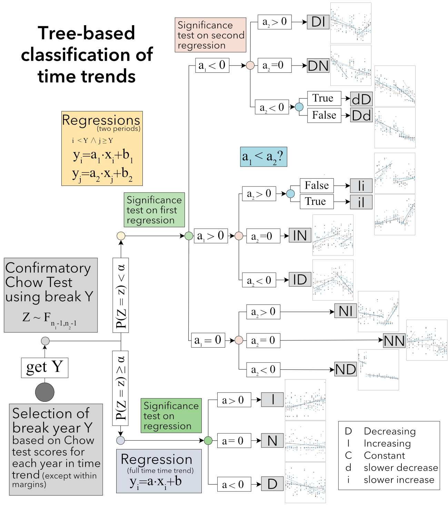

# ChowClassifier

## Description
This code applies a Chow test (or series of Chow tests) on a time-indexed dataset. The 

## Chow test[^1][^2]
We test the significance of the breakpoint under the null hypothesis $Z=\frac{S_c-(S_1+S_2)}{S_1+S_2}\times⋅\frac{N_1+N_2-6}{2}$. This follows a F-distribution with $3$ and $N_1+N_2-6$ degrees of freedom, where $S_C$ is the sum of squared residuals of the regression on the full time series, $S_1$,$S_2$ are the sums of squared residuals of the regression on the first, and respectively, the second half of the time series and $N_1$,$N_2$ are the number of observation for each half.

Tree for classification of the time trends. The classification computes a Chow Test score for each time interval within the dataset to select a possible breakpoint (in case of equal score, the time closer to the middle of the period is favoured). Then using the selected breakpoint, a Chow Test is performed to divide the series whose trend changes around a breakpoint, and those whose trend is steady across the complete time trend. The null hypothesis is that the regressor for the two periods (before and after 2010) are equal . Each trend (either on the full period or on halves) are tested for null slope in the linear regression (α=0.05). The trends are subdivided according to the null hypothesis rejection to either side (significant positive or negative slope) or non-significance. This leads to 3 classes for trends with no significant break point at 2010. And 11 classes for series with significant break point at 2010.

Under the null hypothesis $Z=\frac{S_c-(S_1+S_2)}{S_1+S_2}\times⋅\frac{N_1+N_2-6}{2}$ follows a F-distribution with $3$ and $N_1+N_2-6$ degrees of freedom, where $S_C$ is the sum of squared residuals of the regression on the full time series, $S_1$,$S_2$ are the sums of squared residuals of the regression on the first, and respectively, the second half of the time series and $N_1$,$N_2$ are the number of observation for each half

## Installation

## Use

## References

[^1]: Chow, Gregory C. ‘Test of Equality Between Sets of Coefficients in Two Linear Regressions’. Econometrica 28, no. 3 (1960): 591–605. [jstor.org/stable/1910133](https://www.jstor.org/stable/1910133).

[^2]: Fisher, Franklin M. ‘Tests of Equality Between Sets of Coefficients in Two Linear Regressions: An Expository Note’. Econometrica2 38, no. 2 (1970): 361–66. [jstor.org/stable/1913018](https://www.jstor.org/stable/1913018).
