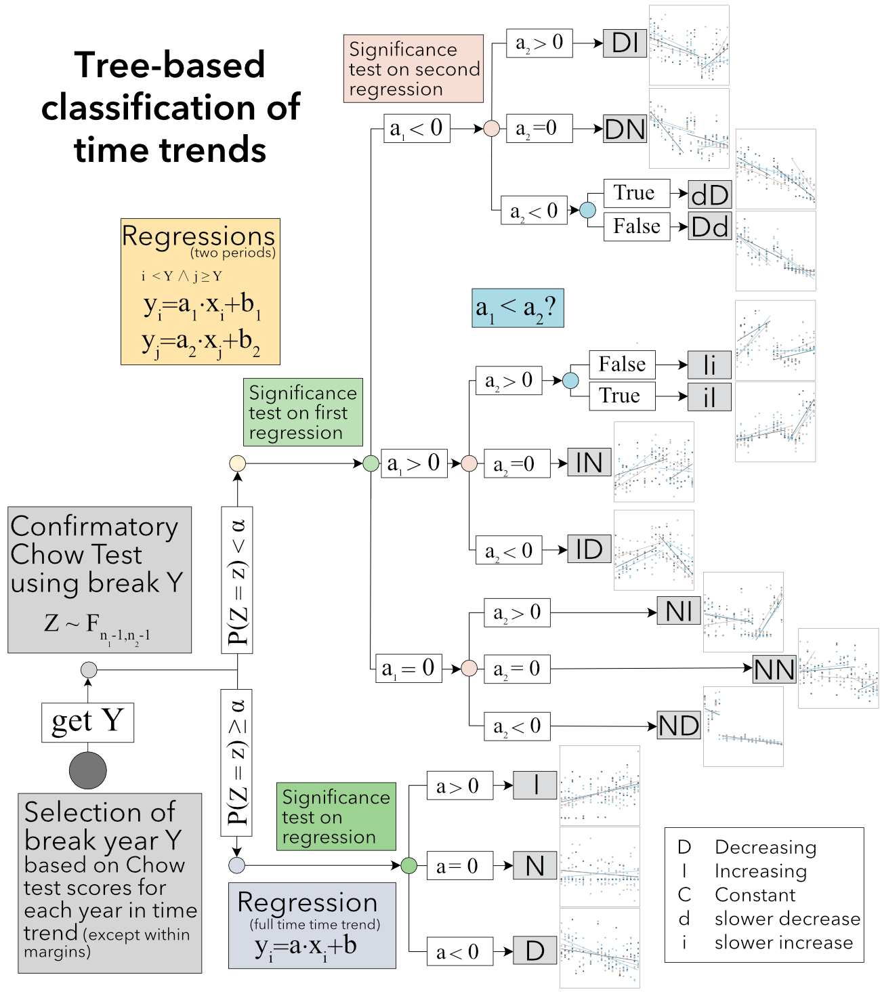

.. chowclassifier documentation master file, created by
   sphinx-quickstart on Sun Jan 15 09:38:47 2023.
   You can adapt this file completely to your liking, but it should at least
   contain the root `toctree` directive.

Welcome to chowclassifier's documentation!
==========================================

.. contents:: Table of Contents

Module Description
==================

Introduction
------------

There are many application where it is useful to analyse rapidly a large number of time-series for overall trends and possible breakpoint at which the trend changes. For example, spotting increasing trends in potential contaminants concentration from the outputs of non-target screening from high resolution mass spectrometry.

ChowClassifier aims to solve this. It is a script that performs a series of Chow tests on a time-indexed dataset to determine if a breakpoint in the time trends is probable. Two classes `Chow` and `ChewData` enable to perform the tests, generate plots and export the results in `csv` and `excel`. Dataset with groups can be ran simultaneously with `ChewData` indicating with `namecol` the name of the grouping column. Calling `run` on a `ChewData` instance will create an instance of `Chow` for each group and classify them into the following categories.

+--------------+----------+----------------------------------------------------------------------------------+
| Breakpoint ? | Category | Description                                                                      |
+--------------+----------+----------------------------------------------------------------------------------+
| No           |N         | non-significant overall trend                                                    |
+--------------+----------+----------------------------------------------------------------------------------+
| No           |   I      | significant increasing overall trend                                             |
+--------------+----------+----------------------------------------------------------------------------------+
| No           | D        | significant decreasing overall trend                                             |
+--------------+----------+----------------------------------------------------------------------------------+
| Yes          | NN       | non-significant trend on set1 and non-significant trend on set2                  |
+--------------+----------+----------------------------------------------------------------------------------+
| Yes          | NI       | non-significant trend on set1 and significant increasing trend on set2           |
+--------------+----------+----------------------------------------------------------------------------------+
| Yes          | ND       | non-significant trend on set1 ans significant decreasing trend on set2           |
+--------------+----------+----------------------------------------------------------------------------------+
| Yes          | IN       | significant increasing trend on set1 and non-significant trend on set2           |
+--------------+----------+----------------------------------------------------------------------------------+
| Yes          | ID       | significant increasing trend on set1 and significant decreasing trend on set2    |
+--------------+----------+----------------------------------------------------------------------------------+
| Yes          | iI       | significant increasing trend on both set1 and set2 with greater increase in set2 |
+--------------+----------+----------------------------------------------------------------------------------+
| Yes          | Ii       | significant increasing trend on both set1 and set2 with greater increase in set1 |
+--------------+----------+----------------------------------------------------------------------------------+
| Yes          | DN       | significant decreasing trend on set1 and non-significant trend on set2           |
+--------------+----------+----------------------------------------------------------------------------------+
| Yes          | DI       | significant decreasing trend on set1 and significant increasing trend on set2    |
+--------------+----------+----------------------------------------------------------------------------------+
| Yes          | dD       | significant decreasing trend on both set1 and set2 with greater decrease in set2 |
+--------------+----------+----------------------------------------------------------------------------------+
| Yes          | Dd       | significant decreasing trend on both set1 and set2 with greater decrease in set1 |
+--------------+----------+----------------------------------------------------------------------------------+

where set1 and set2 indicate respectively the data before the breakpoint and after. The decision process for this classification is shown in the following schema:

Chow test
---------

Chow test was first derived by Gregory Chow [#f1]_ in 1960 and later by Franklin Fisher [#f2]_. We test the significance of the breakpoint at level :math:`\alpha^\star = \frac{\alpha}{m}` (where :math:`m` is the number of breakpoints tests, thus :math:`\alpha^\star` is the Bonferroni corrected significance level)  under the null hypothesis :math:`Z=\frac{S_c-(S_1+S_2)}{S_1+S_2}\cdot\frac{N_1+N_2-2\cdot k}{k}` where :math:`k=3` is the total number of parameters. This follows a F-distribution with :math:`k` and :math:`N_1+N_2-6` degrees of freedom, where :math:`S_C`` is the sum of squared residuals of the regression on the full time series, :math:`S_1`, :math:`S_2` are the sums of squared residuals of the regression on the first, and respectively, the second half of the time series and :math:`N_1`, :math:`N_2` are the number of observation for each half. See also [#f3]_.

.. rubric:: References

.. [#f1] Chow, Gregory C. "Test of Equality Between Sets of Coefficients in Two Linear Regressions". *Econometrica* 28, no. 3 (1960): 591-605. https://www.jstor.org/stable/1910133.
.. [#f2] Fisher, Franklin M. "Tests of Equality Between Sets of Coefficients in Two Linear Regressions: An Expository Note". *Econometrica2* 38, no. 2 (1970): 361-66. https://www.jstor.org/stable/1913018.
.. [#f3] https://en.wikipedia.org/wiki/Chow_test

Installation
------------
Use the following command to install chowlcassifier::

   pip install chowclassifier

Use
---

The script can be ran on any file with ``python -m chowclassifier -f path/to/file/filename.csv -X xcol -y ycol -n grouping_name`` or it can be imported::

   from chowclassifier import ChewData
   # define the path to data
   filepath = "example/data"
   # define the name of the file containing the data (with extension)
   filename = "stocks.csv"
   # define the path where figures will be saved
   savingpath_figures = 'example/fig'
   # what name has the X/time column?
   timecol = 'Date'
   # what name has the y/value column?
   ycol = 'Close'
   # what level of confidence? Note, when
   # testing multiple breakpoint, a Bonferroni correction will be applied
   alpha = 0.01
   # initial breakpoint ?
   initial_breakpoint = None

   C = ChewData(filename = f"{'/'.join([x for x in [filepath,filename] if x not in [None,'']])}",
               timecol = timecol, ycol = ycol, alpha = alpha)

   ########## use the code line below if your X/time column is not a number, e.g. a date
   ########## comment it otherwise
   C.parse_timecol(date_format = '%Y-%m-%d') # 

   C.run(breakpoint = initial_breakpoint)
   C.plot(xlabel = 'time', ylabel='value',# labels given to the axes
         title = "Chow Classification",# title of the main plot
         filename = f"{'/'.join([x for x in [savingpath_figures,filename] if x not in [None,'']])}.png",
         figsize=(16,8),sharey=True)
   C.plot_individually(savingpath = savingpath_figures, format = 'png',
                     xlabel = 'time', ylabel='value',# labels given to the axes
                     )

.. toctree::
   :maxdepth: 2
   :caption: Contents:

Class and method descriptions
=============================

.. toctree::
   :maxdepth: 2

   modules

Licence
-------

GNU LESSER GENERAL PUBLIC LICENSE 
Version 2.1, February 1999

Outputs
=======

``plot`` and ``plot_individually``
----------------------------------
Both methods, plot the best models (either the regression on the whole dataset or, two separate regressions on the left and right parts of the dataset split at breakpoint) for all subdatasets (either each in individual files or together).
The filled area represents the confidence interval for the predicted values in the regression model/models. The scatter points show the observed data. The lines are the regression lines.

``save_to_file``
----------------

The output's columns are described in the following table. ``model0`` correspond to the regression on the whole dataset. ``model1`` and ``model2`` correspond to regressions on respectively the left and right parts of the dataset split at the breakpoint.

+------------+------------------------------+---------------------------------------------------------------------------------------------+
| Model      | property                     | Description of the property                                                                 |
+============+==============================+=============================================================================================+
| Global     | name                         | Name of the group                                                                           |
+------------+------------------------------+---------------------------------------------------------------------------------------------+
| Global     | breakpoint                   | Significant breakpoint (if found)                                                           |
+------------+------------------------------+---------------------------------------------------------------------------------------------+
| Global     | score                        | lowest p-value over the tested breakpoints                                                  |
+------------+------------------------------+---------------------------------------------------------------------------------------------+
| model0     | intercept                    | intercept                                                                                   |
+------------+------------------------------+---------------------------------------------------------------------------------------------+
| model0     | slope                        | slope                                                                                       |
+------------+------------------------------+---------------------------------------------------------------------------------------------+
| model0     | R2                           | coefficient of determination                                                                |
+------------+------------------------------+---------------------------------------------------------------------------------------------+
| model0     | se_intercept                 | standard error for the intercept                                                            |
+------------+------------------------------+---------------------------------------------------------------------------------------------+
| model0     | se_slope                     | standard error for the slope                                                                |
+------------+------------------------------+---------------------------------------------------------------------------------------------+
| model0     | n                            | number of data points used in the fit                                                       |
+------------+------------------------------+---------------------------------------------------------------------------------------------+
| model0     | intercept_pvalue             | p-value of the intercept                                                                    |
+------------+------------------------------+---------------------------------------------------------------------------------------------+
| model0     | slope_pvalue                 | p-value of the slope                                                                        |
+------------+------------------------------+---------------------------------------------------------------------------------------------+
| model0     | intercept_ci_lower           | lower bound of the confidence interval of the intercept                                     |
+------------+------------------------------+---------------------------------------------------------------------------------------------+
| model0     | intercept_ci_upper           | upper bound of the confidence interval of the intercept                                     |
+------------+------------------------------+---------------------------------------------------------------------------------------------+
| model0     | slope_ci_lower               | lower bound of the confidence slope of the intercept                                        |
+------------+------------------------------+---------------------------------------------------------------------------------------------+
| model0     | slope_ci_upper               | upper bound of the confidence interval of the slope                                         |
+------------+------------------------------+---------------------------------------------------------------------------------------------+
|            | alpha                        | significance level at which the regressions were tested                                     |
+------------+------------------------------+---------------------------------------------------------------------------------------------+
|            | alpha_Bonferroni_corrected   | Bonferroni corrected significance level at which the breakpoints were tested                |
+------------+------------------------------+---------------------------------------------------------------------------------------------+
| model1     | intercept                    | intercept                                                                                   |
+------------+------------------------------+---------------------------------------------------------------------------------------------+
| model1     | slope                        | slope                                                                                       |
+------------+------------------------------+---------------------------------------------------------------------------------------------+
| model1     | R2                           | coefficient of determination                                                                |
+------------+------------------------------+---------------------------------------------------------------------------------------------+
| model1     | se_intercept                 | standard error for the intercept                                                            |
+------------+------------------------------+---------------------------------------------------------------------------------------------+
| model1     | se_slope                     | standard error for the slope                                                                |
+------------+------------------------------+---------------------------------------------------------------------------------------------+
| model1     | n                            | number of data points used in the fit                                                       |
+------------+------------------------------+---------------------------------------------------------------------------------------------+
| model1     | intercept_pvalue             | p-value of the intercept                                                                    |
+------------+------------------------------+---------------------------------------------------------------------------------------------+
| model1     | slope_pvalue                 | p-value of the slope                                                                        |
+------------+------------------------------+---------------------------------------------------------------------------------------------+
| model1     | intercept_ci_lower           | lower bound of the confidence interval of the intercept                                     |
+------------+------------------------------+---------------------------------------------------------------------------------------------+
| model1     | intercept_ci_upper           | upper bound of the confidence interval of the intercept                                     |
+------------+------------------------------+---------------------------------------------------------------------------------------------+
| model1     | slope_ci_lower               | lower bound of the confidence slope of the intercept                                        |
+------------+------------------------------+---------------------------------------------------------------------------------------------+
| model1     | slope_ci_upper               | upper bound of the confidence interval of the slope                                         |
+------------+------------------------------+---------------------------------------------------------------------------------------------+
|            | alpha                        | significance level at which the regressions were tested                                     |
+------------+------------------------------+---------------------------------------------------------------------------------------------+
|            | alpha_Bonferroni_corrected   | Bonferroni corrected significance level at which the breakpoints were tested                |
+------------+------------------------------+---------------------------------------------------------------------------------------------+
| model2     | intercept                    | intercept                                                                                   |
+------------+------------------------------+---------------------------------------------------------------------------------------------+
| model2     | slope                        | slope                                                                                       |
+------------+------------------------------+---------------------------------------------------------------------------------------------+
| model2     | R2                           | coefficient of determination                                                                |
+------------+------------------------------+---------------------------------------------------------------------------------------------+
| model2     | se_intercept                 | standard error for the intercept                                                            |
+------------+------------------------------+---------------------------------------------------------------------------------------------+
| model2     | se_slope                     | standard error for the slope                                                                |
+------------+------------------------------+---------------------------------------------------------------------------------------------+
| model2     | n                            | number of data points used in the fit                                                       |
+------------+------------------------------+---------------------------------------------------------------------------------------------+
| model2     | intercept_pvalue             | p-value of the intercept                                                                    |
+------------+------------------------------+---------------------------------------------------------------------------------------------+
| model2     | slope_pvalue                 | p-value of the slope                                                                        |
+------------+------------------------------+---------------------------------------------------------------------------------------------+
| model2     | intercept_ci_lower           | lower bound of the confidence interval of the intercept                                     |
+------------+------------------------------+---------------------------------------------------------------------------------------------+
| model2     | intercept_ci_upper           | upper bound of the confidence interval of the intercept                                     |
+------------+------------------------------+---------------------------------------------------------------------------------------------+
| model2     | slope_ci_lower               | lower bound of the confidence slope of the intercept                                        |
+------------+------------------------------+---------------------------------------------------------------------------------------------+
| model2     | slope_ci_upper               | upper bound of the confidence interval of the slope                                         |
+------------+------------------------------+---------------------------------------------------------------------------------------------+
|            | alpha                        | significance level at which the regressions were tested                                     |
+------------+------------------------------+---------------------------------------------------------------------------------------------+
|            | alpha_Bonferroni_corrected   | Bonferroni corrected significance level at which the breakpoints were tested                |
+------------+------------------------------+---------------------------------------------------------------------------------------------+